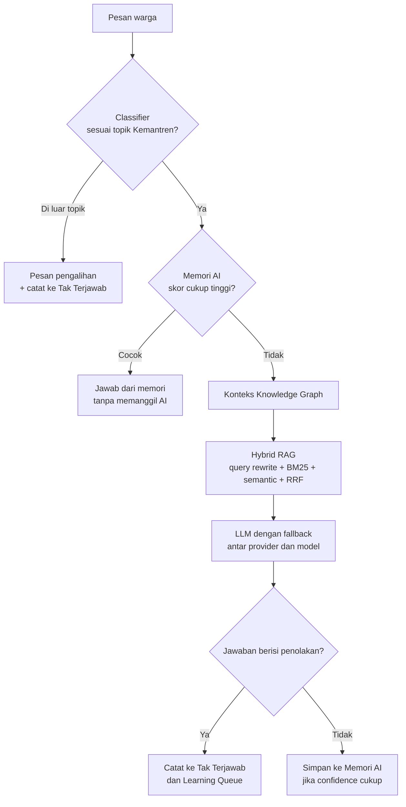

<div align="center">

# 🤖 CATY

### **CHAT AI TEGALREJO YOGYAKARTA**

Asisten virtual Kemantren Tegalrejo untuk layanan administrasi warga, 24 jam, berbasis AI dan buku pengetahuan resmi.


</div>

---

## 📑 Daftar Isi

- [Tentang CATY](#-tentang-caty)
- [Fitur Utama](#-fitur-utama)
- [Cara Kerja Singkat](#-cara-kerja-singkat)
- [Teknologi](#-teknologi)
- [Struktur Folder](#-struktur-folder)
- [Instalasi Cepat](#-instalasi-cepat)
- [Konfigurasi `.env`](#-konfigurasi-env)
- [Menjalankan Aplikasi](#-menjalankan-aplikasi)
- [Mode Penyimpanan: File vs PostgreSQL](#-mode-penyimpanan-file-vs-postgresql)
- [Provider AI](#-provider-ai)
- [Buku Pengetahuan](#-buku-pengetahuan)
- [Dashboard Admin](#-dashboard-admin)
- [Keamanan](#-keamanan)
- [Backup & Restore](#-backup--restore)
- [Catatan Penting & Masalah yang Diketahui](#-catatan-penting--masalah-yang-diketahui)
- [Dokumentasi Lengkap](#-dokumentasi-lengkap)

---

## 📖 Tentang CATY

**CATY** adalah chatbot layanan publik untuk **Kemantren Tegalrejo, Yogyakarta**. Warga bisa bertanya tentang KTP, KK, akta, surat keterangan, izin usaha, pindah domisili, dan layanan lain lewat tampilan chat yang ringan dan bisa dipasang seperti aplikasi (PWA).

Prinsip utamanya: **CATY hanya menjawab dari Buku Pengetahuan yang dikelola admin**. Jika jawabannya tidak ada, CATY tidak mengarang. Ia mengarahkan warga ke petugas, lalu mencatat pertanyaan itu supaya admin bisa menambahkan jawabannya.

Aplikasi terdiri dari dua bagian:

| Bagian | Alamat | Untuk siapa |
|---|---|---|
| **Chat Warga** | `/` | Warga, tanpa login |
| **Dashboard Admin** | `/admin/` | Petugas Kemantren, dengan login |

---

## ✨ Fitur Utama

### Untuk Warga
- 💬 Chat dengan jawaban **streaming** (muncul bertahap, via Server-Sent Events)
- ⚡ **Tombol pertanyaan cepat** yang bisa diatur admin
- 🧠 Saran topik otomatis ketika pertanyaan tidak ditemukan
- 👍👎 **Rating** pada setiap jawaban
- 📋 **Survei kepuasan** otomatis setelah warga diam beberapa menit
- 🌗 Tema dan logo mengikuti pengaturan admin
- 📱 **PWA**: bisa dipasang di layar utama HP

### Untuk Admin
- 📊 **Dashboard** statistik (1 hari, 7 hari, 30 hari, 90 hari, 1 tahun)
- 🔌 **Multi-provider AI** dengan fallback otomatis dan sistem peran (*role*)
- 📚 **Manajer Buku Pengetahuan** (unggah, edit, hapus file `.md` / `.txt`)
- 🕸️ **Knowledge Graph** interaktif dengan pengayaan relasi lewat LLM
- 🧩 **Memori AI**: jawaban yang sudah terbukti disimpan untuk respons instan
- 📥 **Kotak "Tak Terjawab"** dengan antrean prioritas (normal, medium, high, urgent)
- 🎓 **Pipeline belajar terpadu**: satu jawaban admin memperbarui pengetahuan, graph, dan menandai pertanyaan selesai
- 📈 **Laporan** dengan grafik dan cetak **PDF** (ekspor **CSV** tersedia lewat API)
- 🔔 Notifikasi, riwayat percakapan, dan feedback
- 💾 **Backup terenkripsi** otomatis harian dan restore
- 🎨 Kustomisasi nama AI, tagline, logo, tema warna, mode gelap, dan *system prompt*

---

## 🔍 Cara Kerja Singkat

Setiap pesan warga melewati alur berlapis. Lapisan murah dicoba lebih dulu supaya cepat dan hemat biaya API.



Penjelasan lengkap tiap lapisan ada di [`docs/ARSITEKTUR.md`](docs/ARSITEKTUR.md).

---

## 🛠️ Teknologi

| Lapisan | Teknologi |
|---|---|
| Runtime | Node.js (ES Modules, *top-level await*), disarankan **Node 20+** |
| Server | Express 5, Helmet, CORS, `express-rate-limit`, `cookie-parser`, `multer` |
| Autentikasi | JWT (cookie `httpOnly`), `bcrypt` |
| Enkripsi | AES-256-GCM (API key provider dan file backup) |
| Database (opsional) | PostgreSQL lewat `pg` |
| AI | Google Gemini (`@google/genai`) dan provider *OpenAI-compatible* |
| Pencarian | BM25 lokal + embedding (cosine similarity) + Reciprocal Rank Fusion |
| Graph | `graphology` + `compromise` (NLP lokal) |
| Jadwal | `node-cron` |
| Backup | `adm-zip` + `pg_dump` |
| UI warga | HTML/CSS/JS murni, Bootstrap 5.3, Font Awesome 6.4 |
| UI admin | Tabler 1.0 beta, Chart.js 4.4, vis-network 9.1, jsPDF 2.5 + AutoTable 3.8 |

> Versi Express dan `express-rate-limit` disimpulkan dari sintaks kode (`/admin/{*splat}` dan `ipKeyGenerator`). Cocokkan dengan `package.json` Anda.

---

## 📁 Struktur Folder

Struktur di bawah disusun dari path yang dipakai kode. Folder `knowledge/`, `memory/`, `data/`, `logs/`, `tmp/` dibuat otomatis saat server pertama kali jalan.

```
caty/
├── index.js                  # Server utama (API, auth, chat, backup, cron)
├── package.json
├── .env                      # Rahasia, JANGAN di-commit
├── .env.example
│
├── db/
│   └── schema.sql            # Skema PostgreSQL (dijalankan otomatis jika USE_DB=true)
│
├── lib/                      # Modul backend
│   ├── providers.js          # Registry provider AI + fallback chat/embedding
│   ├── provider-role.js      # Sistem peran provider
│   ├── providers-db.js       # CRUD provider di PostgreSQL
│   ├── classifier.js         # Deteksi pertanyaan di luar topik
│   ├── memory.js             # Memori AI + tokenizer, stemmer, sinonim
│   ├── rag-bm25.js           # Pencarian keyword BM25
│   ├── rag-embedding.js      # Semantic search + cache embedding
│   ├── rag-hybrid.js         # Gabungan BM25 + semantic + RRF + query rewrite
│   ├── rag-cache.js          # Cache hasil pencarian (TTL 1 jam)
│   ├── graph-engine.js       # Knowledge graph
│   ├── graph-enricher.js     # Ekstraksi triple via LLM
│   ├── unified-learning.js   # Pipeline jawaban admin
│   ├── learning.js           # Antrean belajar (PostgreSQL)
│   ├── feedback.js           # Feedback + analytics (PostgreSQL)
│   ├── summarizer.js         # Ringkasan pengetahuan + insight harian
│   ├── dashboard-stats.js    # Perhitungan statistik dashboard
│   ├── cetak-laporan.js      # Generator PDF laporan (dijalankan di browser)
│   ├── config-db.js          # Config di PostgreSQL
│   └── db.js                 # Pool koneksi PostgreSQL
│
├── public/                   # Aplikasi warga  →  /
│   ├── index.html            # (file sumber: index_1.html)
│   ├── style.css
│   ├── script.js
│   ├── sw.js
│   ├── manifest.json
│   └── uploads/              # Logo hasil unggahan admin
│
├── admin-public/             # Dashboard admin  →  /admin/
│   ├── index.html            # (file sumber: index.html)
│   ├── style-admin.css
│   ├── script-admin.js
│   ├── dashboard.js
│   ├── laporan.js
│   ├── sw-admin.js
│   └── manifest-admin.json
│
├── knowledge/                # Buku pengetahuan (.md / .txt)
│   └── buku-pengetahuan.md
├── memory/
│   ├── memory.md             # Memori (mode file)
│   └── sessions/             # Sesi percakapan (JSON, TTL 2 jam)
├── data/                     # config, graph, cache embedding, backup, dll.
│   ├── knowledge-graph.json
│   ├── embedding-cache.json
│   ├── unanswered.json
│   └── backups/              # Backup terenkripsi (*.zip.enc)
├── logs/notifications.json
└── tmp/                      # File sementara (upload, proses backup)
```

> ⚠️ Pada file yang Anda kirim, halaman **warga** bernama `index_1.html` dan halaman **admin** bernama `index.html`. Saat menaruhnya ke folder, ubah keduanya menjadi `index.html` di `public/` dan `admin-public/`.

---

## 🚀 Instalasi Cepat

### Prasyarat
- **Node.js 20+** dan npm
- **PostgreSQL 14+** (hanya jika memakai `USE_DB=true`)
- `pg_dump` di PATH (hanya jika memakai PostgreSQL dan ingin backup otomatis)
- Minimal **satu API key** provider AI (Gemini dan Groq punya paket gratis)

### Langkah

```bash
# 1. Ambil kode
git clone <url-repo-anda> caty
cd caty

# 2. Pasang dependensi
npm install express cors helmet multer express-rate-limit bcrypt jsonwebtoken \
            cookie-parser node-cron adm-zip dotenv pg @google/genai \
            graphology compromise

# 3. Salin konfigurasi
cp .env.example .env

# 4. Buat secret (jalankan dua kali, satu untuk tiap nilai)
node -e "console.log(require('crypto').randomBytes(32).toString('hex'))"
# → tempel ke JWT_SECRET dan ENCRYPTION_KEY di .env

# 5. Jalankan
node index.js
```

Pastikan `package.json` memuat `"type": "module"` karena seluruh kode memakai `import`.

Jika sukses, konsol menampilkan:

```
CATY siap di http://localhost:3000
Warga  : http://localhost:3000/
Admin  : http://localhost:3000/admin/
```

Selanjutnya: login di `/admin/`, buka **Provider AI** lalu tambahkan API key, lalu isi **Buku Pengetahuan**.

---

## ⚙️ Konfigurasi `.env`

| Variabel | Wajib | Keterangan |
|---|:---:|---|
| `JWT_SECRET` | ✅ | Minimal **32 karakter**. Server berhenti jika kosong atau terlalu pendek. |
| `ENCRYPTION_KEY` | ✅ | Tepat **64 karakter hex** (32 byte). Mengenkripsi API key dan backup. **Jika hilang, API key tersimpan dan backup lama tidak bisa dibuka.** |
| `ADMIN_USERNAME` | – | Default `admin`. |
| `ADMIN_PASSWORD_HASH` | ✳️ | Hash bcrypt (diawali `$2`). **Disarankan.** |
| `ADMIN_PASSWORD` | ✳️ | Password polos, di-hash saat start. Dipakai jika hash tidak ada. |
| `PORT` | – | Default `3000`. |
| `NODE_ENV` | – | Isi `production` agar cookie login memakai flag `secure` (wajib HTTPS). |
| `USE_DB` | – | `true` untuk memakai PostgreSQL. Default: mode file. |
| `DATABASE_URL` | – | Connection string PostgreSQL (SSL aktif otomatis). Alternatif dari `PG*`. |
| `PGHOST` `PGPORT` `PGDATABASE` `PGUSER` `PGPASSWORD` | – | Alternatif `DATABASE_URL`. Default: `localhost`, `5432`, `db_caty`, `postgres`. |
| `BACKUP_KEEP_COUNT` | – | Jumlah file backup yang disimpan. Default `4`. |

✳️ Isi salah satu. Jika keduanya kosong, server memakai password bawaan `admin123` dan menulis peringatan di log. **Jangan biarkan ini di produksi.**

Membuat hash bcrypt:

```bash
node -e "require('bcrypt').hash('PasswordKuat!', 10).then(console.log)"
```

Contoh lengkap ada di [`.env.example`](.env.example).

---

## ▶️ Menjalankan Aplikasi

```bash
node index.js               # jalankan biasa
node --watch index.js       # mode pengembangan (Node 18.11+)
```

Pengecekan kesehatan: `GET /api/health` menampilkan uptime, provider, jumlah chunk, memori, sesi, status graph, dan statistik RAG.

Panduan produksi (Nginx, HTTPS, PM2, systemd): [`docs/DEPLOYMENT.md`](docs/DEPLOYMENT.md).

---

## 🗄️ Mode Penyimpanan: File vs PostgreSQL

| Data | `USE_DB=false` (file) | `USE_DB=true` (PostgreSQL) |
|---|---|---|
| Konfigurasi | `data/config.json` | tabel `config` |
| Provider AI (terenkripsi) | `data/providers.json.enc` | tabel `providers` |
| Memori AI | `memory/memory.md` | tabel `memory` |
| **Feedback** | ❌ nonaktif | ✅ tabel `feedback` |
| **Analytics** | ❌ nonaktif | ✅ tabel `analytics_events` |
| **Learning Queue** | ❌ nonaktif | ✅ tabel `learning_queue` |
| Pertanyaan tak terjawab | `data/unanswered.json` | `data/unanswered.json` (tetap file) |
| Sesi percakapan | `memory/sessions/*.json` | `memory/sessions/*.json` (tetap file) |
| Notifikasi | `logs/notifications.json` | `logs/notifications.json` (tetap file) |
| Buku pengetahuan, graph, cache embedding | file | file |

> **Penting:** fitur feedback, analytics, dan learning queue hanya berfungsi dengan `USE_DB=true`. Tanpa itu, dashboard menampilkan nol untuk data tersebut. Untuk penggunaan nyata, **pakai PostgreSQL**.

Detail tabel: [`docs/DATABASE.md`](docs/DATABASE.md).

---

## 🔌 Provider AI

CATY memanggil provider secara berurutan. Jika satu gagal, ia mencoba model berikutnya lalu provider berikutnya.

**Bawaan:** Google Gemini, Groq, OpenRouter, Cerebras, Together AI, Mistral AI, DeepSeek, Fireworks AI, xAI Grok.
**Kustom:** provider apa pun yang kompatibel dengan OpenAI (isi *Custom Endpoint*).

Setiap provider bisa punya satu atau lebih **peran**:

| Peran | Fungsi |
|---|---|
| `chat` | Menjawab warga |
| `embedding` | Membuat vektor untuk semantic search (Gemini, Together, Mistral, atau kustom) |
| `enrichment` | Mengekstrak relasi untuk Knowledge Graph dan pipeline belajar |
| `query-rewriter` | Peran terdaftar; pada kode saat ini penulisan ulang query memakai provider berperan `chat` |

API key **dienkripsi AES-256-GCM** sebelum disimpan dan hanya ditampilkan sebagian (*masked*) di dashboard.

> Daftar nama model bawaan ada di `lib/providers.js`. Nama model provider sering berubah, jadi periksa dokumentasi provider dan perbarui lewat menu **Provider AI → Edit Model**.

---

## 📚 Buku Pengetahuan

Taruh file `.md` atau `.txt` di folder `knowledge/` atau unggah lewat dashboard (maks. 5 MB per file). Sistem memecahnya menjadi *chunk* per judul (`##` sampai `######`). Tanpa judul, dipecah per paragraf.

Format yang disarankan:

```markdown
# Buku Pengetahuan CATY

## Syarat Pembuatan KTP Elektronik

Kata kunci : ktp, ktp-el, kartu tanda penduduk, buat ktp baru

Pertanyaan : Apa saja syarat membuat KTP baru?

Jawaban : Syarat pembuatan KTP baru:
• Fotokopi Kartu Keluarga
• Fotokopi Akta Kelahiran
• Surat pengantar RT/RW
• Formulir permohonan

Kategori : Administrasi
```

Tips:
- Satu topik per judul. Chunk yang fokus memberi hasil pencarian lebih akurat.
- Baris `Kata kunci :` dipakai sebagai sinyal tambahan. Isi dengan istilah dan singkatan yang biasa dipakai warga.
- Judul bergaya `## BAGIAN 1 ...` dilewati (dianggap pembatas).
- Setelah mengubah file, klik **Reload** di dashboard. Perubahan lewat dashboard langsung dimuat ulang otomatis.

---

## 🖥️ Dashboard Admin

Buka `/admin/` lalu login. Menu:

| Grup | Halaman | Fungsi |
|---|---|---|
| – | **Dashboard** | Statistik, grafik aktivitas, sumber jawaban, tren feedback, topik populer, kategori |
| Provider AI | **Semua Provider** | Tambah, uji, aktif/nonaktif, atur peran dan model |
| Pengetahuan | **Buku Pengetahuan** | Kelola file pengetahuan |
| | **Knowledge Graph** | Visualisasi graph, detail node, pengayaan via LLM |
| | **Memori AI** | Lihat, ubah, hapus memori |
| Monitoring | **Tak Terjawab** | Antrean pertanyaan yang perlu dijawab admin |
| | **Feedback & Akurasi** | Rating warga dan akurasi |
| | **Laporan** | Laporan periode, cetak PDF dan Print |
| | **Percakapan** | Riwayat sesi aktif |
| | **Notifikasi** | Peringatan sistem |
| Sistem | **Backup** | Backup manual, unduh, restore |
| Konfigurasi | **Identitas** | Nama AI, tagline, logo, tema, kontak, survei, tombol cepat |
| | **Prompt AI** | System prompt dan parameter memori/percakapan |
| | **Keamanan** | Ganti password |

Panduan langkah demi langkah: [`docs/PANDUAN-ADMIN.md`](docs/PANDUAN-ADMIN.md).

---

## 🔒 Keamanan

Yang sudah diterapkan:

- Login admin dengan **JWT** di cookie `httpOnly` + `sameSite=lax` (berlaku 30 hari)
- Password di-hash **bcrypt**; ganti password lewat dashboard menulis hash baru ke `.env`
- API key provider dan file backup dienkripsi **AES-256-GCM**
- **Rate limit**: API umum 500 permintaan / 15 menit, login 10 gagal / 15 menit, chat per sesi (default 20 / menit)
- Path sensitif diblokir: `.env`, `config.json`, `package.json`, `/knowledge/`, `/memory/`, `/data/`, `/tmp/`, `/node_modules/`
- Upload dibatasi: logo (gambar, 2 MB), pengetahuan (`.md`/`.txt`, 5 MB), nama file disanitasi
- Pesan chat dibatasi 2000 karakter

Yang perlu Anda perhatikan sebelum produksi ada di bagian berikutnya.

---

## 💾 Backup & Restore

- **Otomatis** setiap hari pukul **02.00** (zona waktu server), menyimpan sejumlah `BACKUP_KEEP_COUNT` terbaru
- **Manual** lewat menu **Backup**
- Format `*.zip.enc` terenkripsi dengan `ENCRYPTION_KEY`

Isi backup: dump PostgreSQL (`database_dump.sql`, jika `USE_DB=true`), folder `knowledge/`, `knowledge-graph.json`, dan `embedding-cache.json`.

Catatan restore ada di bagian berikut. Panduan lengkap: [`docs/DEPLOYMENT.md`](docs/DEPLOYMENT.md#backup--restore).

---

## ⚠️ Catatan Penting & Masalah yang Diketahui

Saya menemukan hal-hal berikut saat membaca kode. Tidak ada yang menghalangi aplikasi berjalan, tetapi sebaiknya ditangani.

### Keamanan
1. **Password bawaan `admin123`** dipakai jika `.env` tidak berisi password. Selalu isi `ADMIN_PASSWORD_HASH`.
2. **CORS** diset `origin: true` dengan `credentials: true`, artinya semua asal diizinkan. Batasi ke domain Anda di produksi.
3. **Content-Security-Policy dimatikan** (`helmet`) agar CDN Chart.js dan vis-network berjalan. Pertimbangkan mengaktifkannya dengan daftar CDN yang diizinkan.
4. Token JWT juga dikembalikan di body respons login dan disimpan di variabel JS dashboard (bukan `localStorage`). Itu cukup aman, tetapi cookie `httpOnly` sebenarnya sudah memadai, jadi token di body bisa dihapus jika tidak diperlukan.

### Perilaku yang mungkin tidak sesuai harapan
5. **Batas chat per sesi tidak ikut berubah.** `rateLimitPerSession` dibaca saat limiter dibuat, sebelum `CONFIG` dimuat, sehingga nilainya selalu 20/menit walau admin mengubahnya.
6. **Restore tidak mengimpor `database_dump.sql`.** Restore hanya memulihkan file. Impor dump secara manual: `psql -d <db> -f database_dump.sql`.
7. **Backup tidak mencakup** `unanswered.json`, `memory/sessions/`, dan `notifications.json`. Restore mencari beberapa file JSON lama (`config.json`, `feedback.json`, dst.) yang tidak dibuat oleh backup saat ini.
8. **Insight harian (cron 23.00) dihitung tetapi tidak disimpan.** Fungsi ringkasan membaca kunci `summaries` di tabel `config`, tetapi tidak ada kode yang menuliskannya, sehingga daftar ringkasan selalu kosong.
9. **Classifier memakai pencocokan substring.** Kata seperti `sim`, `ml`, atau `kue` bisa tertangkap di dalam kata lain (misalnya "simpan"). Pertanyaan baru dialihkan hanya jika tidak ada kata kunci layanan yang cocok, tetapi tetap ada risiko salah alih.
10. **Statistik `sessions` harian** pada analytics selalu 0 karena event tidak menyimpan hitungan sesi unik. Grafik memakai jumlah pesan.
11. **Tabel `sessions`, `messages`, `unanswered_questions`, `knowledge_chunks`, `notifications`** ada di `schema.sql`, tetapi kode yang saya baca masih memakai file untuk data tersebut.
12. Nomor kontak di `systemInstruction` bawaan (WA `0812-3456-7890`, telp `(0274) 123456`) adalah **contoh** dan berbeda dari `contactInfo`. Ganti sebelum dipakai.

### Penamaan
13. Sisa nama lama **SIVT / SIVTY** masih ada di beberapa tempat. Daftar dan dampaknya ada di [`docs/ARSITEKTUR.md`](docs/ARSITEKTUR.md#penamaan-yang-masih-memakai-sivt). Hati-hati: header backup `SIVTBK01` jangan diubah tanpa migrasi karena backup lama tidak akan terbaca.

### PWA
14. `sw-admin.js` memakai strategi *cache-first* untuk JS/CSS, sehingga pembaruan admin bisa tertunda. Naikkan `CACHE_NAME` setiap rilis atau samakan dengan `sw.js` warga yang *network-first*.
15. Meta viewport warga memakai `user-scalable=no`, yang menyulitkan pengguna yang perlu memperbesar tampilan.
16. Ikon manifest 192 dan 512 memakai satu file `logo.png`. Sediakan dua ukuran asli, dan pisahkan `any` dari `maskable`. Unggahan logo disimpan dengan ekstensi aslinya (`logo.jpg`, `logo.webp`, ...), sehingga ikon PWA hanya cocok jika logo diunggah sebagai **PNG**.

---

## 📚 Dokumentasi Lengkap

| Dokumen | Isi |
|---|---|
| [`docs/ARSITEKTUR.md`](docs/ARSITEKTUR.md) | Alur chat, RAG, memori, graph, pipeline belajar, PWA, penamaan |
| [`docs/API.md`](docs/API.md) | Seluruh endpoint REST beserta contoh |
| [`docs/DATABASE.md`](docs/DATABASE.md) | Skema PostgreSQL dan pemetaan modul |
| [`docs/DEPLOYMENT.md`](docs/DEPLOYMENT.md) | Instalasi server, Nginx, HTTPS, PM2, backup, pemecahan masalah |
| [`docs/PANDUAN-ADMIN.md`](docs/PANDUAN-ADMIN.md) | Panduan penggunaan dashboard untuk petugas |

---

<div align="center">

Dibuat untuk **Kemantren Tegalrejo, Kota Yogyakarta** 🏛️

</div>
