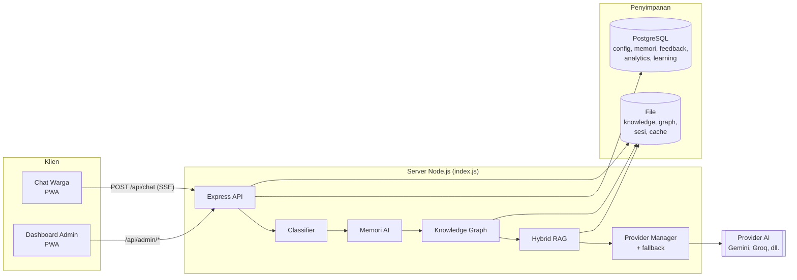
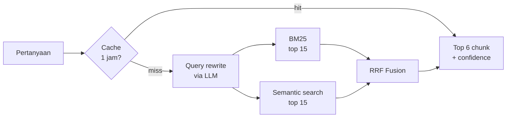
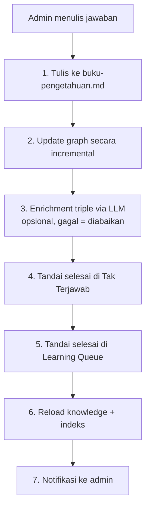

# 🏗️ Arsitektur CATY

Dokumen ini menjelaskan cara kerja internal CATY: dari pesan warga masuk sampai jawaban keluar, lalu bagaimana sistem belajar dari pertanyaan yang belum terjawab.

## Daftar Isi

1. [Gambaran Umum](#1-gambaran-umum)
2. [Alur Pemrosesan Chat](#2-alur-pemrosesan-chat)
3. [Classifier](#3-classifier)
4. [Memori AI](#4-memori-ai)
5. [Hybrid RAG](#5-hybrid-rag)
6. [Knowledge Graph](#6-knowledge-graph)
7. [Provider AI dan Fallback](#7-provider-ai-dan-fallback)
8. [Pipeline Belajar Terpadu](#8-pipeline-belajar-terpadu)
9. [Sesi, Analytics, dan Feedback](#9-sesi-analytics-dan-feedback)
10. [Tugas Terjadwal](#10-tugas-terjadwal)
11. [Frontend dan PWA](#11-frontend-dan-pwa)
12. [Penamaan yang Masih Memakai SIVT](#penamaan-yang-masih-memakai-sivt)

---

## 1. Gambaran Umum



Seluruh backend ada di satu proses Node.js. Tidak ada antrean pesan atau layanan terpisah, sehingga mudah dipasang di satu VPS kecil.

---

## 2. Alur Pemrosesan Chat

Endpoint: `POST /api/chat`. Respons berupa **Server-Sent Events** (`text/event-stream`), bukan JSON biasa.

Urutan langkah di `index.js`:

| # | Langkah | Hasil jika cocok | Biaya API |
|--:|---|---|---|
| 1 | Validasi pesan (tidak kosong, maks. 2000 karakter) | Error 400 | – |
| 2 | Buat atau ambil sesi | – | – |
| 3 | **Classifier**: relevan dengan Kemantren? | Pesan pengalihan, event `out_of_scope`, dicatat ke Tak Terjawab | – |
| 4 | **Memori AI**: ada jawaban tersimpan yang cukup mirip? | Jawab dari memori, event `memory` | – |
| 5 | **Konteks Knowledge Graph** (`maxDepth 1`, `maxNodes 15`) | Ditambahkan ke prompt | – |
| 6 | **Hybrid RAG** (top 6 chunk) | Ditambahkan ke prompt jika *confidence* ≥ 40 | 0–2 panggilan |
| 7 | Susun riwayat percakapan + konteks | – | – |
| 8 | **LLM dengan fallback** antar provider dan model | Teks jawaban | 1+ panggilan |
| 9 | Bersihkan Markdown (`cleanAIText`) lalu stream per 8 karakter | – | – |
| 10 | Deteksi **penolakan** (regex) | Event `refusal`, masuk Tak Terjawab dan Learning Queue | – |
| 11 | Jika bukan penolakan: event `answer` (+ `rag` bila confidence ≥ 70) | – | – |
| 12 | Simpan ke **Memori** bila ada konteks, confidence ≥ 40, jawaban lengkap | – | – |

### Format event SSE

Setiap baris berbentuk `data: {json}\n\n`. Jenis objek yang dikirim:

| Objek | Arti |
|---|---|
| `{ "sessionId": "sess_..." }` | ID sesi (pertama kali, disimpan klien) |
| `{ "meta": { "source": "memory" \| "redirect" \| "ai", ... } }` | Info sumber jawaban, skor, provider, model |
| `{ "delta": "teks..." }` | Potongan teks jawaban |
| `{ "needSuggestions": true, "suggestions": ["..."] }` | Saran topik ketika konteks kosong |
| `{ "error": "pesan" }` | Kesalahan |
| `{ "done": true }` | Selesai |

### Aturan penolakan

Jawaban dianggap **penolakan** jika cocok dengan pola seperti "belum ada di buku", "tidak tahu", "hubungi petugas langsung". System prompt bawaan memaksa AI memakai kalimat baku saat jawaban tidak ada di buku, sehingga deteksi ini andal. **Jika Anda mengubah kalimat baku di System Prompt, ubah juga regex ini di `index.js`**, kalau tidak, penolakan tidak akan tercatat sebagai Tak Terjawab.

---

## 3. Classifier

`lib/classifier.js`, murni lokal tanpa panggilan API.

1. Jika pertanyaan mengandung kata **di luar topik** (politik, cuaca, saham, game, film, resep, obat, hukum pidana, pajak kendaraan, SIM/STNK, dan sebagainya) **dan tidak** mengandung kata layanan, hasilnya `redirect`.
2. Jika ada kata kunci layanan (KTP, KK, akta, surat, domisili, usaha, izin, jam buka, dst.), hasilnya `proceed` dengan *confidence* `50 + 15 × jumlah_kata`, maksimal 100.
3. Jika tidak ada kata kunci tetapi cocok dengan chunk pengetahuan, `proceed` dengan *confidence* `30 + 20 × jumlah_chunk`.
4. Selain itu: `proceed_with_caution` (tetap lanjut ke RAG).

> Pencocokan memakai `includes()` pada teks, bukan batas kata. Daftar kata pendek seperti `sim`, `ml`, `kue` dapat cocok di dalam kata lain. Jika sering terjadi salah alih, ubah ke pencocokan berbatas kata (`\b`) atau hapus kata yang terlalu pendek.

Untuk menyesuaikan cakupan, edit dua daftar di bagian atas file: `OUT_OF_SCOPE_KEYWORDS` dan `IN_SCOPE_KEYWORDS`.

---

## 4. Memori AI

`lib/memory.js`. Memori adalah kumpulan pasangan pertanyaan–jawaban yang sudah terbukti. Jawaban dari memori **gratis dan instan**.

### Penilaian kecocokan

Setiap item memori dinilai terhadap pertanyaan baru:

| Sinyal | Skor |
|---|--:|
| Kata sama | +5 per kata |
| Kata dasar (stem) sama | +4 per kata |
| Pasangan kata (bigram) sama | +15 per pasangan |
| Pertanyaan persis sama | +50 |
| Persis sama dengan salah satu variasi | +40 |
| Riwayat penggunaan (`hit`) | +1 sampai +3 |
| Topik sama (KTP, KK, akta, dst.) | +25 per topik |
| Topik **bertentangan** | **−40** |

Memori dipakai jika skor ≥ `memoryMinScore` (default **75**). Skor ≥ 100 langsung dipercaya. Skor di antaranya divalidasi lagi oleh `validateMemoryRelevance` (topik harus beririsan, dan ≥ 40% kata atau ≥ 2 kata cocok).

### Kapan jawaban disimpan

`memoryAdd` hanya menyimpan jawaban jika:
- panjang ≥ 50 karakter,
- bukan penolakan atau pengalihan,
- tidak berakhir dengan `:` atau `...` (tanda jawaban terpotong).

Jika pertanyaan sangat mirip dengan item lama (skor ≥ `memorySaveThreshold`, default **55**) dan topiknya sama, item lama di-*update*: `hit` naik, variasi ditambah (maks. 10), dan jawaban diganti jika yang baru lebih panjang.

### Normalisasi bahasa

`memory.js` juga menjadi pustaka teks bersama:
- `SYNONYMS`: "bikin/membuat/urus" → *buat*, "gimana" → *bagaimana*, "persyaratan" → *syarat*, "akte" → *akta*, "harga/tarif/bayar" → *biaya*, dst.
- `STOPWORDS`: kata umum yang diabaikan.
- `stemID`: stemmer sederhana (awalan dan akhiran umum).
- `tokenize`, `makeBigrams`: dipakai juga oleh BM25 dan classifier.

Untuk menambah istilah lokal warga, tambahkan ke `SYNONYMS`.

---

## 5. Hybrid RAG

`lib/rag-hybrid.js`, `rag-bm25.js`, `rag-embedding.js`, `rag-cache.js`.



### Lapisan

1. **Cache** (`RAGCache`): hasil dikunci dengan hash kueri yang dinormalisasi. TTL 1 jam, maks. 500 entri.
2. **Query rewrite** (`rewriteQuery`): LLM mengubah kalimat warga menjadi 3–5 kata kunci ("cara bikin KTP yang ilang" → "syarat KTP hilang, prosedur KTP hilang"). Jika gagal, memakai kueri asli. Memakai provider berperan `chat`.
3. **BM25** (`k1=1.5`, `b=0.75`): pencarian kata kunci pada teks yang sudah di-*stem*. Selalu aktif dan tidak butuh API.
4. **Semantic search**: embedding kueri dibandingkan dengan embedding tiap chunk memakai *cosine similarity*. **Hanya aktif jika ada provider berperan `embedding`.** Vektor di-cache di `data/embedding-cache.json` selama 7 hari dan disimpan otomatis tiap 5 menit.
5. **RRF** (*Reciprocal Rank Fusion*, `K=60`): menggabungkan dua daftar peringkat menjadi satu, tanpa perlu menyamakan skala skor.

### Confidence

Dihitung dari skor RRF teratas:

| Skor RRF teratas | Confidence |
|---|--:|
| ≥ 0,030 | 100 |
| ≥ 0,020 | 70 |
| ≥ 0,015 | 40 |
| > 0 | 20 |

Konteks buku pengetahuan hanya dimasukkan ke prompt jika **confidence ≥ 40**. Confidence ≥ 70 dicatat sebagai event `rag` di analytics.

> Skor RRF maksimum teoretis dengan dua daftar adalah sekitar 0,033. Jadi tanpa provider embedding (hanya BM25), skor tertinggi sekitar 0,0164 dan confidence mentok di 40. Artinya event `rag` (≥ 70) praktis hanya tercapai bila embedding aktif.

### Pemecahan dokumen (*chunking*)

`loadKnowledge()` membaca semua `.md`/`.txt` di `knowledge/`:
- Ada judul Markdown → dipecah di setiap `##` sampai `######`.
- Tidak ada judul → dipecah per paragraf.
- Chunk di bawah 20 karakter dibuang. Judul `BAGIAN n` dilewati.

Setelah dimuat, indeks BM25 dan embedding dibangun ulang di latar belakang.

---

## 6. Knowledge Graph

`lib/graph-engine.js` memakai **graphology** (struktur graph) dan **compromise** (NLP lokal).

- **Node** = konsep (mis. "kartu keluarga", "surat pengantar"), **edge** = hubungan antar konsep.
- Dibangun otomatis dari buku pengetahuan lewat `addKnowledge()`: entitas diekstrak lokal, dibersihkan dengan daftar *stopword* yang ketat.
- Batas: **20.000 node**, **60.000 edge**. Tersimpan otomatis tiap 60 detik ke `data/knowledge-graph.json`, dimuat ulang saat server start.
- Saat chat, `queryContext()` mengambil node yang relevan dan tetangganya sebagai teks konteks tambahan untuk LLM.

### Pengayaan (enrichment) via LLM

`lib/graph-enricher.js` meminta LLM mengekstrak *triple* `(subjek, predikat, objek)` dari teks, misalnya `("akta kelahiran", "memerlukan", "kartu keluarga")`. Dijalankan dari dashboard (**Knowledge Graph → Enrich**) dengan default 30 chunk dan 2 proses paralel. Hanya satu proses enrich boleh berjalan sekaligus. Provider berperan `enrichment` dipakai lebih dulu; jika tidak ada, provider aktif mana pun.

### Rebuild

**Rebuild** mengosongkan graph lalu membangun ulang dari seluruh buku pengetahuan. Berguna setelah banyak file diubah. Triple hasil enrichment ikut hilang dan perlu dijalankan ulang.

---

## 7. Provider AI dan Fallback

`lib/providers.js`, `provider-role.js`, `providers-db.js`.

### Urutan fallback

```
untuk setiap provider aktif (urutan di dashboard):
    untuk setiap model milik provider:
        coba panggil → berhasil? kembalikan hasil
        gagal? tunggu 200 ms, coba model berikutnya
    semua model gagal → lanjut provider berikutnya
semua gagal → error "Semua provider AI gagal" + notifikasi ke admin
```

Provider kustom (punya `customEndpoint`) hanya mencoba model pertamanya.

### Syarat provider dianggap aktif

`enabled` bukan `false`, API key ≥ 5 karakter, dan peran yang dibutuhkan terdaftar. Provider tanpa field `roles` dianggap `chat`.

### Penyimpanan API key

- Mode file: seluruh daftar provider dienkripsi ke `data/providers.json.enc`.
- Mode PostgreSQL: kolom `api_key_enc` per provider.
- Format enkripsi: `iv:authTag:ciphertext` (hex), AES-256-GCM, kunci dari `ENCRYPTION_KEY`.

### Menambah provider bawaan baru

Tambahkan entri di objek `PROVIDERS` pada `lib/providers.js`. Untuk API yang kompatibel OpenAI, cukup `call: callOpenAICompatible` dan `baseUrl`. Tanpa mengubah kode, Anda juga bisa menambahkannya lewat dashboard sebagai provider kustom.

---

## 8. Pipeline Belajar Terpadu

Saat CATY gagal menjawab, pertanyaan masuk ke **Tak Terjawab** (`unanswered.json`) dan **Learning Queue** (PostgreSQL, dikelompokkan jika mirip ≥ 85% dan diberi prioritas dari frekuensi).

| Frekuensi | Prioritas |
|--:|---|
| 1–2 | normal |
| 3–4 | medium |
| 5–9 | high |
| ≥ 10 | urgent |

Ketika admin menjawab lewat dashboard, `processAdminAnswer` (`lib/unified-learning.js`) menjalankan **satu alur untuk semuanya**:



Blok yang ditambahkan ke buku pengetahuan:

```markdown
## <judul dari pertanyaan>

Kata kunci : <pertanyaan>

Pertanyaan : <pertanyaan>

Jawaban : <jawaban admin>

Kategori : <opsional>
```

Pipeline dinyatakan sukses jika langkah 1 (simpan ke pengetahuan) berhasil. Kegagalan langkah lain dicatat di `errors` tanpa membatalkan sisanya.

---

## 9. Sesi, Analytics, dan Feedback

### Sesi

- Disimpan di memori proses dan di `memory/sessions/<id>.json` (ditulis tertunda 1,5 detik).
- **TTL 2 jam** tanpa aktivitas. Pembersihan tiap 30 menit.
- Maksimal **30 pesan** per sesi; riwayat yang dikirim ke AI mengikuti `conversationHistorySize` (default 20).
- Sesi dimuat kembali saat server restart dan disimpan saat `SIGINT`.
- Sisi klien menyimpan ID sesi di `localStorage` (`sivt_sessionId`); tombol **Reset** menghapusnya.

### Analytics

Setiap interaksi mencatat satu baris di `analytics_events`:

| `event_type` | Dicatat saat |
|---|---|
| `answer` | AI menjawab (bukan penolakan) |
| `memory` | Dijawab dari memori |
| `rag` | AI menjawab dengan konteks RAG confidence ≥ 70 |
| `refusal` | Jawaban berupa penolakan |
| `out_of_scope` | Dialihkan classifier |

Sumber jawaban di dashboard dihitung dari event ini. `accuracyRate = (total − refusal) / total`.

### Feedback

Tombol 👍/👎 mengirim `POST /api/feedback` dengan `rating` `good` atau `bad`. Pertanyaan dipotong 500 karakter, jawaban 1000 karakter.

### Survei kepuasan

Timer di klien menampilkan modal setelah warga tidak aktif selama `surveyIdleMinutes` (default 3 menit) bila `surveyEnabled` aktif. Tombol **Ya, Isi Survei** membuka `surveyLink`.

---

## 10. Tugas Terjadwal

| Jadwal (cron) | Tugas | Catatan |
|---|---|---|
| `0 2 * * *` (02.00) | `runBackup()` | Backup terenkripsi lalu hapus yang lama |
| `0 23 * * *` (23.00) | `generateDailyInsight()` | Hasil saat ini tidak disimpan |
| Tiap 30 menit | `sessionCleanup()` | Hapus sesi kedaluwarsa |
| Tiap 5 menit | Auto-save cache embedding | Jika ada perubahan |
| Tiap 60 detik | Auto-save graph | Jika ada perubahan |
| Tiap 10 menit | Bersihkan cache RAG kedaluwarsa | – |

Zona waktu cron mengikuti zona waktu server. Untuk WIB, atur `TZ=Asia/Jakarta`.

---

## 11. Frontend dan PWA

### Aplikasi warga

- `script.js`: membaca `/api/config/public` (nama, logo, tema, tombol cepat, survei), mengirim pesan via `fetch` lalu membaca stream SSE, menampilkan tombol rating dan saran topik.
- `sw.js` (cache `sivt-ai-v4`): **network-first** untuk HTML/JS/CSS, **cache-first** untuk aset lain. Melewati `/api/`, `/uploads/`, dan domain eksternal.
- `manifest.json`: `start_url: /`, tampilan `standalone`, orientasi `portrait`, tema hitam.

### Dashboard admin

- Tabler (UI), Chart.js (grafik), vis-network (graph), jsPDF + AutoTable (PDF).
- `script-admin.js` (navigasi, provider, pengetahuan, memori, backup, dll.), `dashboard.js` (statistik), `laporan.js` (laporan) dan `cetak-laporan.js` (PDF; dilayani dari `/lib/cetak-laporan.js`).
- Autentikasi: cookie `admin_token` plus header `Authorization: Bearer`.
- `sw-admin.js` (cache `caty-admin-v1`) dengan scope `/admin/`. Server mengirim header `Service-Worker-Allowed: /admin/` dan `no-cache` untuk file service worker.
- `manifest-admin.json`: `start_url` dan `scope` `/admin/`, tema biru `#0d47a1`.

### Tema

Warna, logo, dan mode gelap diatur dari dashboard (**Identitas**). Tema hanya diterapkan ke halaman warga jika `themeApplyToWarga` aktif.

---

## Penamaan yang Masih Memakai SIVT

Nama yang benar adalah **CATY**. Sisa nama lama yang masih ada di kode:

| Lokasi | Nilai lama | Dampak jika diganti |
|---|---|---|
| `public/index.html` | `<title>SIVT AI - ...</title>`, teks survei "layanan CATY" sudah benar | Aman |
| `public/sw.js` | cache `sivt-ai-v4` | Aman; cache lama otomatis dihapus saat aktivasi |
| `public/script.js` | kunci `localStorage` `sivt_sessionId` | Warga aktif kehilangan sesi sekali |
| `public/manifest.json` | nama "SIVTY AI - Sistem Informasi Virtual TEGALREJO YOGYAKARTA" | Aman; pengguna perlu pasang ulang PWA untuk melihat nama baru |
| `admin-public/script-admin.js` | kunci `localStorage` `sivt-theme` | Pengaturan mode gelap admin direset sekali |
| `admin-public/manifest-admin.json` | "SIVTY AI Admin Dashboard" | Aman |
| `lib/providers.js` | header `X-Title: SIVT AI Chatbot` | Aman |
| `lib/unified-learning.js` | judul file "Buku Pengetahuan SIVT AI" | Aman |
| `index.js` (system prompt) | kalimat baku "buku catatan SIVT" | **Ubah juga regex penolakan** (lihat bagian 2) |
| `index.js` (memori mode file) | header "Memori SIVT AI" | Aman |
| `index.js` (backup) | magic header `SIVTBK01` | **Jangan diubah** tanpa migrasi, backup lama jadi tidak terbaca |
| `index.js` (default config) | `aiName: 'CATY'` | Sudah benar |

Kepanjangan CATY yang dipakai di kode: **CHAT AI TEGALREJO YOGYAKARTA**.
