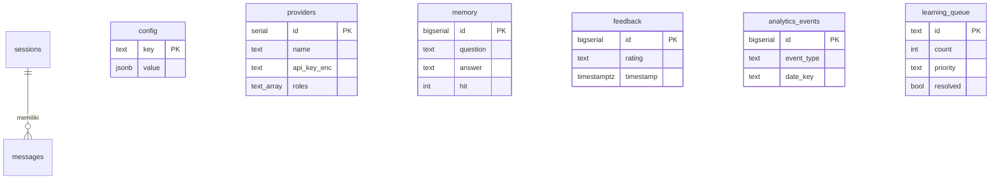

# 🗄️ Dokumentasi Database

CATY memakai **PostgreSQL** bila `USE_DB=true`. Skema ada di `db/schema.sql` dan dijalankan otomatis saat server start (semua perintah memakai `CREATE TABLE IF NOT EXISTS`, jadi aman dijalankan berulang).

## Daftar Isi

- [Menyiapkan Database](#menyiapkan-database)
- [Ringkasan Tabel](#ringkasan-tabel)
- [Detail Tabel](#detail-tabel)
- [Diagram Relasi](#diagram-relasi)
- [Kueri Berguna](#kueri-berguna)
- [Catatan Penting](#catatan-penting)

---

## Menyiapkan Database

```bash
# 1. Buat database (sebagai superuser)
sudo -u postgres psql -c "CREATE DATABASE db_caty;"
sudo -u postgres psql -c "CREATE USER caty WITH PASSWORD 'ganti_password';"
sudo -u postgres psql -c "GRANT ALL PRIVILEGES ON DATABASE db_caty TO caty;"

# PostgreSQL 15+: beri hak pada skema public
sudo -u postgres psql -d db_caty -c "GRANT ALL ON SCHEMA public TO caty;"

# 2. Isi .env
USE_DB=true
PGHOST=localhost
PGDATABASE=db_caty
PGUSER=caty
PGPASSWORD=ganti_password

# 3. Jalankan server — tabel dibuat otomatis dari db/schema.sql
node index.js
```

Atau buat tabel manual: `psql -d db_caty -f db/schema.sql`.

Jika memakai `DATABASE_URL`, koneksi memakai SSL dengan `rejectUnauthorized: false` dan parameter `uselibpqcompat=true` ditambahkan otomatis. Untuk database lokal tanpa SSL, gunakan variabel `PG*`.

> Backup memakai `pg_dump` dengan `PGHOST`, `PGUSER`, `PGDATABASE`, dan `PGPASSWORD`. Jika Anda memakai `DATABASE_URL`, isi juga variabel `PG*` agar backup otomatis berfungsi.

---

## Ringkasan Tabel

| Tabel | Dipakai oleh | Isi | Dipakai kode saat ini? |
|---|---|---|:---:|
| `config` | `config-db.js`, `summarizer.js` | Pengaturan aplikasi (key → JSON) | ✅ |
| `providers` | `providers-db.js` | Provider AI + API key terenkripsi | ✅ |
| `memory` | `memory.js` | Memori jawaban | ✅ |
| `feedback` | `feedback.js` | Rating warga | ✅ |
| `analytics_events` | `feedback.js` | Event interaksi | ✅ |
| `learning_queue` | `learning.js` | Antrean pertanyaan belum terjawab | ✅ |
| `sessions` | – | Sesi chat | ⚠️ belum* |
| `messages` | – | Pesan chat | ⚠️ belum* |
| `unanswered_questions` | – | Pertanyaan tak terjawab | ⚠️ belum* |
| `knowledge_chunks` | – | Chunk pengetahuan | ⚠️ belum* |
| `notifications` | – | Notifikasi admin | ⚠️ belum* |

\* Tabel sudah dibuat oleh skema, tetapi pada kode yang saya baca data ini masih disimpan di file (`memory/sessions/*.json`, `data/unanswered.json`, `logs/notifications.json`, `knowledge/*.md`). Tabel-tabel ini tampaknya disiapkan untuk migrasi berikutnya. Aman dibiarkan kosong.

---

## Detail Tabel

### `config`
Penyimpanan key-value untuk seluruh pengaturan.

| Kolom | Tipe | Keterangan |
|---|---|---|
| `key` | TEXT, PK | Nama pengaturan (mis. `aiName`, `theme`, `systemInstruction`) |
| `value` | JSONB, NOT NULL | Nilai (disimpan dengan `JSON.stringify`) |
| `updated_at` | TIMESTAMPTZ | Default `NOW()` |

Saat dimuat, nilai bawaan (`DEFAULT_CONFIG`) digabung dengan isi tabel; objek `theme` digabung per kunci. Kunci khusus `summaries` dibaca oleh `summarizer.js` untuk daftar ringkasan.

### `providers`

| Kolom | Tipe | Keterangan |
|---|---|---|
| `id` | SERIAL, PK | |
| `name` | TEXT | Kunci provider (`gemini`, `groq`, atau nama kustom) |
| `display_name` | TEXT | Nama tampilan |
| `api_key_enc` | TEXT | API key terenkripsi AES-256-GCM, format `iv:tag:cipher` (hex) |
| `roles` | TEXT[] | Default `{chat}` |
| `models` | TEXT[] | Model chat |
| `embedding_models` | TEXT[] | Model embedding |
| `custom_endpoint` | TEXT | URL dasar API OpenAI-compatible (untuk provider kustom) |
| `enabled` | BOOLEAN | Default `TRUE` |
| `created_at`, `updated_at` | TIMESTAMPTZ | |

Jika `models` kosong, kode memakai daftar bawaan dari `lib/providers.js`.

### `memory`

| Kolom | Tipe | Keterangan |
|---|---|---|
| `id` | BIGSERIAL, PK | |
| `timestamp` | TEXT | Waktu ISO saat dibuat |
| `title` | TEXT | Judul singkat (maks. 60 karakter) |
| `question` | TEXT | Pertanyaan yang sudah dinormalisasi (huruf kecil) |
| `answer` | TEXT | Jawaban (maks. 3000 karakter) |
| `variants` | TEXT[] | Variasi pertanyaan (maks. 10) |
| `keywords` | TEXT[] | Kata kunci (maks. 10) |
| `hit` | INTEGER | Berapa kali dipakai |

> `memorySaveDB` menyimpan dengan cara **hapus semua lalu isi ulang** dalam satu transaksi. Aman secara data, tetapi `id` berubah setiap penyimpanan, jadi jangan menjadikan `id` memori sebagai rujukan luar.

### `feedback`

| Kolom | Tipe | Keterangan |
|---|---|---|
| `id` | BIGSERIAL, PK | |
| `question` | TEXT | Maks. 500 karakter |
| `answer` | TEXT | Maks. 1000 karakter |
| `rating` | TEXT | `good` atau `bad` |
| `session_id` | TEXT | |
| `provider`, `model`, `source` | TEXT | Asal jawaban |
| `timestamp` | TIMESTAMPTZ | |

### `analytics_events`

| Kolom | Tipe | Keterangan |
|---|---|---|
| `id` | BIGSERIAL, PK | |
| `event_type` | TEXT | `answer`, `memory`, `rag`, `refusal`, `out_of_scope` |
| `session_id` | TEXT | |
| `ts` | BIGINT | Epoch milidetik |
| `date_key` | TEXT | `YYYY-MM-DD` (waktu lokal server) |

### `learning_queue`

| Kolom | Tipe | Keterangan |
|---|---|---|
| `id` | TEXT, PK | Format `lq_<timestamp>_<acak>` |
| `question` | TEXT | Versi dinormalisasi |
| `original` | TEXT | Teks asli warga |
| `variants` | TEXT[] | Variasi yang digabung (maks. 10) |
| `count` | INTEGER | Berapa kali ditanyakan |
| `priority` | TEXT | `normal` / `medium` / `high` / `urgent` |
| `first_asked`, `last_asked` | TIMESTAMPTZ | |
| `resolved` | BOOLEAN | |

Pertanyaan yang mirip ≥ 85% (jarak Levenshtein) digabung ke item yang sudah ada.

### Tabel yang belum dipakai

`sessions`, `messages`, `unanswered_questions`, `knowledge_chunks`, `notifications`: lihat skema di `db/schema.sql`. `messages.session_id` merujuk `sessions.id` dengan `ON DELETE CASCADE`.

---

## Diagram Relasi



Tabel selain `sessions`/`messages` berdiri sendiri (tanpa *foreign key*); keterkaitannya lewat `session_id` berupa teks biasa.

---

## Kueri Berguna

```sql
-- Jawaban dengan rating buruk terbaru
SELECT question, provider, model, timestamp
FROM feedback WHERE rating = 'bad'
ORDER BY timestamp DESC LIMIT 20;

-- Tingkat kepuasan
SELECT rating, COUNT(*) FROM feedback GROUP BY rating;

-- Distribusi sumber jawaban 7 hari terakhir
SELECT event_type, COUNT(*)
FROM analytics_events
WHERE date_key >= TO_CHAR(NOW() - INTERVAL '7 days', 'YYYY-MM-DD')
GROUP BY event_type;

-- Pertanyaan paling sering belum terjawab
SELECT original, count, priority
FROM learning_queue WHERE resolved = FALSE
ORDER BY count DESC LIMIT 20;

-- Memori yang paling sering dipakai
SELECT title, hit FROM memory ORDER BY hit DESC LIMIT 20;

-- Provider terdaftar (tanpa membuka API key)
SELECT id, name, roles, enabled FROM providers ORDER BY id;
```

---

## Catatan Penting

- **Tanpa `USE_DB=true`**, modul `feedback`, `learning`, dan analytics tidak menyimpan data sama sekali (fungsi langsung `return`). Dashboard akan menampilkan nol untuk bagian tersebut.
- **Indeks:** skema hanya mendefinisikan *primary key*. Untuk data besar, pertimbangkan:
  ```sql
  CREATE INDEX IF NOT EXISTS idx_feedback_ts ON feedback (timestamp DESC);
  CREATE INDEX IF NOT EXISTS idx_events_date ON analytics_events (date_key, event_type);
  CREATE INDEX IF NOT EXISTS idx_lq_pending ON learning_queue (resolved, priority);
  ```
- **Pertumbuhan data:** `analytics_events` bertambah satu baris per interaksi dan tidak dipangkas otomatis. Hapus data lama secara berkala bila perlu, atau gunakan tombol **Hapus Analytics** di dashboard.
- **Pastikan `days` angka:** `getDailyFeedbackStats(days)` menyisipkan nilai `days` langsung ke teks SQL. Saat ini nilainya selalu melalui `parseInt`, jadi aman. Jika Anda memanggilnya dari tempat lain, pastikan tetap berupa bilangan bulat.
- **Zona waktu:** `date_key` dibuat dari waktu lokal server, sedangkan pengelompokan harian feedback memakai `TO_CHAR(timestamp, ...)` pada zona waktu sesi PostgreSQL. Samakan zona waktu server dan database (mis. `Asia/Jakarta`) agar grafik harian konsisten.
